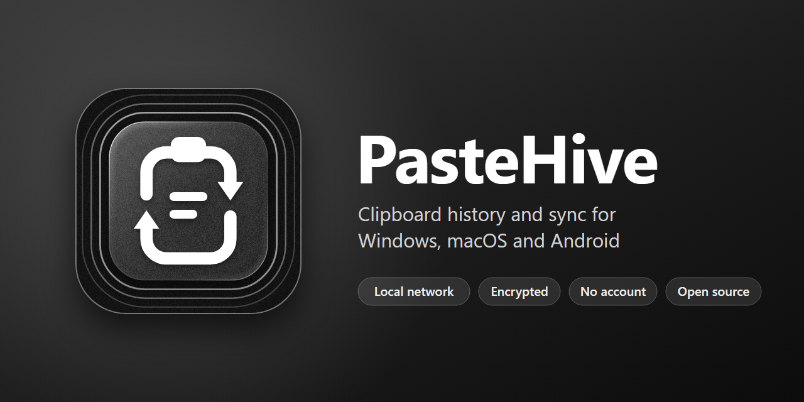
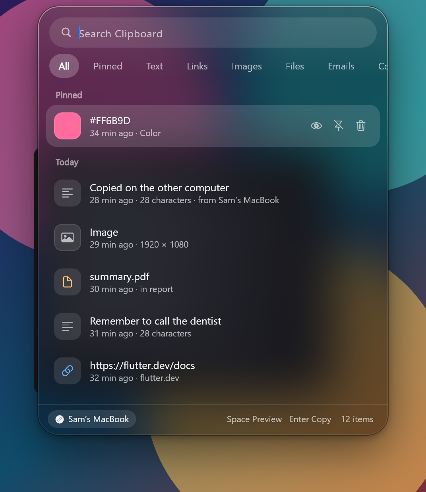
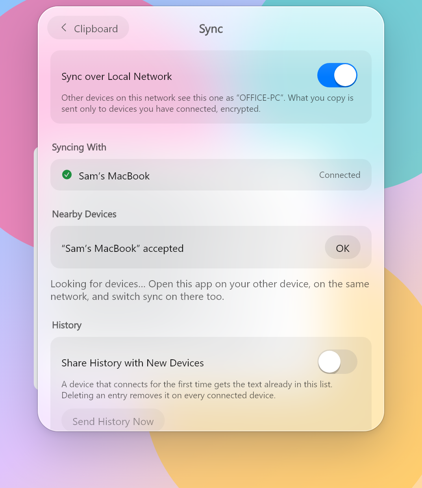

<p align="center">
  
</p>

<h1 align="center">PasteHive: clipboard manager and clipboard sync</h1>

<p align="center">
  A free, open-source clipboard manager for <b>Windows</b>, <b>macOS</b> and <b>Android</b>.<br>
  It keeps a searchable history of everything you copy and syncs your clipboard between your own devices
  over the local network, encrypted, with no cloud and no account.
</p>

<p align="center">
  <b>Website: <a href="https://yeamin-talukder.github.io/PasteHive/">yeamin-talukder.github.io/PasteHive</a></b>
</p>

<p align="center">
  <a href="https://github.com/Yeamin-Talukder/PasteHive/releases/latest"></a>
  <a href="https://github.com/Yeamin-Talukder/PasteHive/releases/latest"></a>
  <a href="https://github.com/Yeamin-Talukder/PasteHive/releases/latest"></a>
  
  <br>
  <sub>The buttons open the <a href="https://github.com/Yeamin-Talukder/PasteHive/releases/latest">latest release</a>. No release is published yet; until one is, <a href="#build-from-source">build from source</a>.</sub>
</p>

<p align="center">
  <a href="https://github.com/Yeamin-Talukder/PasteHive/releases/latest"></a>
  <a href="https://github.com/Yeamin-Talukder/PasteHive/releases"></a>
  
  <a href="https://github.com/Yeamin-Talukder/PasteHive/stargazers"></a>
  <a href="https://github.com/Yeamin-Talukder/PasteHive/forks"></a>
  <a href="https://github.com/Yeamin-Talukder/PasteHive/issues"></a>
  <br>
  <a href="https://github.com/Yeamin-Talukder/PasteHive/commits/main"></a>
  
  
  
  <a href="LICENSE"></a>
</p>

<p align="center">
  <a href="https://yeamin-talukder.github.io/PasteHive/">Website</a> ·
  <a href="#features">Features</a> ·
  <a href="#download">Download</a> ·
  <a href="#sync-your-clipboard-between-devices">Sync</a> ·
  <a href="#keyboard-shortcuts">Shortcuts</a> ·
  <a href="#privacy-and-security">Privacy</a> ·
  <a href="#faq">FAQ</a> ·
  <a href="#build-from-source">Build</a>
</p>

<p align="center">
  
  &nbsp;
  
</p>

## What is PasteHive?

PasteHive is a clipboard history app that stays out of the way. On a computer it
lives in the background: push the pointer to the top middle of the screen and a
glass panel drops down with everything you copied. Click an entry, or press
Enter, and it is pasted where you were typing.

Switch sync on and your devices become one hive: what you copy on one lands on
the clipboard of the others. Nothing is sent to a server. Devices find each
other on your Wi-Fi or wired network and talk directly, encrypted.

## Features

**Clipboard history**

- Records text, pictures (screenshots, images copied from a page or an editor)
  and files copied in a file manager, newest first.
- Groups entries under Pinned, Today, Yesterday, This Week and Earlier.
- Search as you type, and filter by All, Pinned, Text, Links, Images, Files,
  Emails, Colors and Synced.
- Recognises links, email addresses and hex colours. A colour is shown as a
  swatch and a picture as a thumbnail.
- Preview an entry in full, pin it, or delete it. A deleted entry can be
  brought back for a few seconds.
- Copying the same thing again moves it to the top instead of adding a
  duplicate.

**Clipboard sync**

- Copy on one device, paste on another: text and pictures.
- Pair devices by request and accept, checked with a six-digit code. There is
  no key to type and no account to create.
- More than two devices can share one group: pair a new device with any
  member and it syncs with all of them.
- Deleting an entry, undoing the delete and Clear History carry over to every
  connected device.
- Optionally share the text already in your history with a newly connected
  device.

**Made to stay out of the way**

- No taskbar button and no Dock icon. A tray icon (Windows) or menu bar icon
  (macOS) offers Show Clipboard, Sync Settings, Pause Capturing, start at
  login, Clear History and Quit.
- Opens when the pointer rests at the top middle of any screen. Closes when
  the pointer leaves, on Esc, or when you click elsewhere.
- Picking an entry pastes it straight into the app you were working in.
- Light and dark appearance, an opaque fallback when more contrast is
  requested, and no motion when reduced motion is on.

**About and updates**

- The ⓘ button at the bottom of the panel opens **About**: the version you
  are running, the developer, and links to the website, the source code, the
  issue tracker and the license.
- PasteHive looks for a newer release once a day (it can be switched off) and
  marks the ⓘ button when there is one. **Download and Install** fetches it,
  checks it against the release's published checksum, and installs it:
  Windows and macOS replace the app and start it again, Android hands the
  download to the system installer. Nothing is installed without you pressing
  the button.

## Platforms

| Platform | What you get | Status |
| --- | --- | --- |
| Windows | Background panel, history, paste into the previous app, sync | The most used and tested build |
| macOS | Background panel, history, paste (needs the Accessibility permission), sync | Release builds pass the app's self-checks; less tested on real hardware |
| Android | Full-screen history, filters, preview, sync | Early. See the limits below |
| iOS | Not available yet | Planned |

Android does not let an app watch the clipboard in the background. On a phone
PasteHive reads the clipboard each time it comes to the front, and also takes
text from Share, from the text-selection menu, and from the **Send clipboard**
button in its notification or quick-settings tile. While sync is on, a
notification keeps the connection alive. Text and pictures copied on another
device are put on the phone's clipboard, and a picture copied on the phone is
sent to the others. A large photo is made smaller first, so that it fits the
5 MB limit as a PNG.

**Sending copies automatically on Android.** Switch on the PasteHive
accessibility service (Sync Settings, **This Phone**) and what you copy in any
app is sent by itself, with the app closed. The service only notices that
something was copied; it does not read the screen. Android treats this as a
restricted setting for apps installed from outside the Play Store, so it has to
be allowed once under the app's App Info page. It has been tested on Android 17
on a Pixel.

## Download

| Platform | Get it | File |
| --- | --- | --- |
| Windows | [Latest release](https://github.com/Yeamin-Talukder/PasteHive/releases/latest) | Installer or zip |
| macOS | [Latest release](https://github.com/Yeamin-Talukder/PasteHive/releases/latest) | App bundle |
| Android | [Latest release](https://github.com/Yeamin-Talukder/PasteHive/releases/latest) | APK |
| iOS | Coming soon | |

There is no packaged release yet, so the links above have nothing to offer
for now. When the first release is published its files will be listed there,
and the download badge at the top of this page will start counting. Until then,
[build it from source](#build-from-source); it takes one command per platform.

## Sync your clipboard between devices

Sync is off until you switch it on, and no network port is opened before then.

1. Put your devices on the same network.
2. Open **Sync Settings** on each (the button at the bottom left of the panel,
   or the tray menu) and switch on **Sync over Local Network**.
3. On one device, choose the other under **Nearby Devices** and press
   **Connect**.
4. The other device shows the request with a six-digit code. Check that both
   show the same code, then press **Accept**.

From then on, what you copy on either one is put on the other's clipboard and
added to its list. Pairing a third device with any member of the group makes it
sync with all of them. **Pause Capturing** stops both sending and receiving, and
**Stop Syncing with All Devices** leaves the group.

Things to know:

- The first time sync is switched on, Windows asks whether to let the app
  through the firewall, and macOS asks for access to the local network. Sync
  needs both to be allowed.
- Networks that keep devices apart (guest Wi-Fi, some office networks) will
  not work.
- Text and pictures are synced. Pictures larger than 5 MB as PNG stay on the
  device where they were copied. Files are never sent: a path means nothing on
  another machine.
- A device that is off or away when something is deleted does not hear about
  it.

## Keyboard shortcuts

| Key | Does |
| --- | --- |
| Type | Search |
| Up / Down | Move through the list |
| Enter | Paste the selected entry where you were typing, and close |
| Space | Preview the selected entry (while the search field is empty) |
| Tab / Shift+Tab | Next / previous filter |
| Delete | Delete the selected entry (while the search field is empty) |
| Ctrl+Z (Cmd+Z) | Bring back the entry just deleted |
| Ctrl+P (Cmd+P) | Pin or unpin the selected entry |
| Esc | Close the preview, clear the search, reset the filter, then close |

Windows does not deliver a paste to a program running as administrator, so
nothing is pasted there; the entry is still on the clipboard.

## Privacy and security

- **No cloud, no account, no telemetry.** Your clipboard goes only to devices
  you have accepted, directly over your own network.
- **One request to GitHub a day, for updates.** To learn whether a newer
  version exists, the app asks GitHub's public API for the latest release of
  this repository. The request carries nothing about you, your device or
  your clipboard (GitHub sees your network address, as any website does).
  Switch **Check Automatically** off in About to stop it; a download from
  GitHub happens only when you press **Download and Install**.
- **Encrypted in transit.** Each connection does a fresh X25519 key exchange,
  derives its keys from that and the group's key together (HKDF-SHA256), and
  encrypts every message with ChaCha20-Poly1305. A device without the group's
  key can neither join nor read.
- **Visible on your network while sync is on.** Devices announce themselves by
  name over UDP (port 45817, multicast group 239.255.77.67 and broadcast) so
  that others on the same network can find them. What you copy is sent only
  to devices you have accepted.
- **Stored on your device, unencrypted.** History is kept in `history.json` in
  the app's support folder as plain text, copied pictures as PNG files in an
  `images` folder beside it (at most 40 unpinned ones), and the group's key in
  `sync.json`. Anyone with access to your user account can read them.
- **Not independently reviewed.** The protocol is assembled from standard parts
  but was written for this app and has not had a security audit. Do not rely on
  it for secrets you could not afford to leak.

## FAQ

**Is PasteHive free?**
Yes. It is open source under the MIT license.

**Does my clipboard go through a server?**
No. Devices connect to each other directly on the local network. There is no
PasteHive server.

**Does it work over the internet, away from home?**
No. Both devices have to be on the same local network.

**Can I copy on Windows and paste on a Mac or an Android phone?**
Yes, for text and pictures, once the devices are paired.

**Does it replace the Windows clipboard history (Win+V) or Apple's Universal Clipboard?**
It works alongside them. PasteHive adds search, filters, pinning and sync
between Windows, macOS and Android, which those do not cover together.

**How much battery does it use?**
On a Windows laptop the idle app measured about 1.8% of one CPU core. On a
phone, keeping sync on in the background costs more; switch sync off when you
do not need it.

**Does it capture passwords?**
It records whatever is copied. Use **Pause Capturing** before copying something
you do not want kept, or delete the entry afterwards.

## Build from source

You need [Flutter](https://docs.flutter.dev/get-started/install) and the
platform's own toolchain (Visual Studio for Windows, Xcode for macOS, Android
Studio for Android).

```powershell
git clone https://github.com/Yeamin-Talukder/PasteHive.git
cd PasteHive
flutter pub get
```

Run it:

```powershell
flutter run -d windows
flutter run -d macos
flutter run -d android
```

Build a release:

```powershell
flutter build windows
flutter build macos
flutter build apk
```

The project folder, the Dart package and the binaries are still called
`pastehive`; only the name shown to users is PasteHive.

## For developers

### Checks

```powershell
flutter analyze
flutter test
```

Render the panel to PNG files in `build/previews/` without launching the app:

```powershell
$env:PANEL_PREVIEW = "1"; flutter test test/ui/panel_preview_test.dart
```

Ask the built app to open its panel, report what the system said, save a
picture of the panel as drawn (`build\smoke.png`, with made-up entries rather
than your history) and quit:

```powershell
$env:SYNC_CLIPBOARD_SMOKE = "$PWD\build\smoke.json"; .\build\windows\x64\runner\Debug\pastehive.exe
```

### How the glass is drawn

The two desktop systems need different approaches.

- **Windows** blurs behind a window only while that window is the active one,
  and a panel that opens on hover often is not. So the app's window is a
  transparent sheet and the app draws the glass itself: just before the panel
  opens it reads the pixels of the screen where the panel will be, blurs them,
  and draws the panel over that with its own rounded shape, edge highlight and
  shadow. One spring animates all of it and the window never moves. The
  picture is taken once per opening, so what is behind the glass does not
  update while the panel is open.
- **macOS** blurs behind any window, so there the window itself is the panel,
  on the system's vibrancy material with the system's corners and shadow.

### Layout

| Path | What is there |
| --- | --- |
| `lib/src/history/` | Entries, the history list, saving to disk |
| `lib/src/shell/` | The top-edge gesture and opening/closing the panel |
| `lib/src/platform/` | `ports.dart` (interfaces) and `native_ports.dart` (the real desktop, via `nativeapi`) |
| `lib/src/sync/` | Group key, encrypted channel, the sync service, and `network.dart` (real UDP and TCP) |
| `lib/src/ui/` | The panel, its animation, and the sync settings view |
| `lib/src/mobile/` | The Android app |
| `lib/src/update/` | App details, the release check, and the per-platform installers |
| `tool/` | `generate_app_icons.dart` and `generate_tray_icons.dart` write every icon from `design/logo/` |
| `lib/src/app_shell.dart` | Ties capture, tray and panel together |
| `design/logo/` | Logo sources, icon exports and the banner |
| `website/` | The [website](https://yeamin-talukder.github.io/PasteHive/), published by GitHub Actions |
| `.github/workflows/` | Build and test, release, and website publishing |

Everything that touches the operating system is behind an interface in
`ports.dart`, so the logic and the UI are tested with fakes.

## Contributing

Bug reports and ideas are welcome in
[Issues](https://github.com/Yeamin-Talukder/PasteHive/issues).
For a code change, run `flutter analyze` and `flutter test` before opening a
pull request.

If PasteHive is useful to you, a star helps other people find it.

## License

MIT. See [LICENSE](LICENSE).
